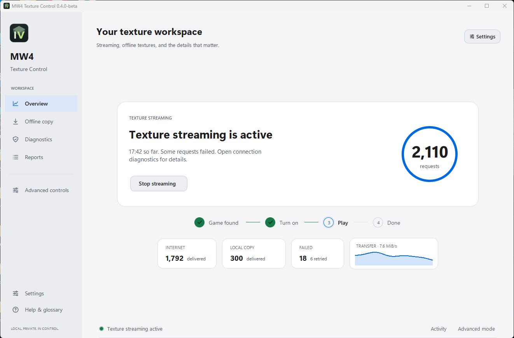

# MW4 Texture Control

A Windows app for managing MW4 texture streaming, downloading an offline texture copy, and checking your streaming session.



## Download and install

Open [Releases](https://github.com/SanX4/mw4-texture-control/releases) and download:

- **MW4-Texture-Control-0.4.0-beta-Setup.exe** to install the app and its Start menu shortcuts.
- **MW4-Texture-Control-0.4.0-beta-win64-portable.zip** to run it from an extracted folder.

Requires 64-bit Windows 10 or 11 and your own game installation. Python is not needed for either download. The window runs normally. Windows requests administrator permission only for hosts changes or protected game setup.

## How to use

1. Close the game, then open **MW4 Texture Control**.
2. Read the first-run notice and select your game folder.
3. Choose **While I play** for streaming, or **Download them once** for an offline copy.
4. If prompted, complete the one-time game setup. The app keeps backups for undo.
5. Press **Turn on HD textures**, then launch the game and leave the app running.
6. After closing the game, turn the session off to restore the hosts entry and view your session report.

For an offline copy, open **Settings → Offline copy**, choose where to save it under **Settings → Offline storage**, and start the download. Downloads can be paused and resumed. Keep the app running during play even when using an offline copy.

- [Step-by-step instructions](docs/GETTING-STARTED.md)
- [Settings and troubleshooting](docs/USAGE.md)
- [Offline texture downloads](docs/TEXTURE-PACK.md)

The session counters show delivered requests and data, rather than guaranteeing a particular visual result in the game.

More views: [Settings](docs/images/settings.png) · [Offline copy](docs/images/offline-copy.png) · [Connection diagnostics](docs/images/diagnostics.png).

Screenshots use demonstration statistics.

## Connection and session controls

Open **Settings → Connection diagnostics** for the current CDN address, fallback status, last successful delivery, and failure details. The overview separates internet deliveries, local-copy deliveries, and failures.

**Stop streaming** leaves offline downloads running. **Pause downloads** leaves streaming active. **Stop everything** ends both. Disk protection pauses new transfers at its limit; force-closing the game requires an explicit setting and confirmation.

Use **Settings → Text size** for 100%, 115%, or 130% text. Settings supports Tab, Shift+Tab, Enter, Space, and Escape.

## Settings and recovery

Installed settings and reports are stored in `%LOCALAPPDATA%\MW4TextureControl`. The portable edition stores them in its `data` folder.

If a session was interrupted, use **Restore hosts** from the Start menu or app folder. To uninstall the installed edition, use Windows **Settings → Apps**. The uninstaller offers to stop active helpers and remove the app's hosts entry; it asks before removing saved settings.

## Run from source

With Python 3.10 or newer (including Tkinter):

```powershell
python tools\ccsgui.py
```

To build the Windows installer and portable archive, use 64-bit Python 3.12 and Inno Setup 6:

```powershell
packaging\build.bat
```

Builds use pinned dependencies from `packaging/requirements-build.txt`. Outputs appear in `packaging/out/`. The build includes packaged-app checks and installer lifecycle checks.

## Reference

[Reference app on GitHub](https://github.com/voidfnc/mw4-texture-streaming-research)

## License

[MIT](LICENSE). This app includes no game assets or texture packs. See [Disclaimer](DISCLAIMER.md) for usage terms.
